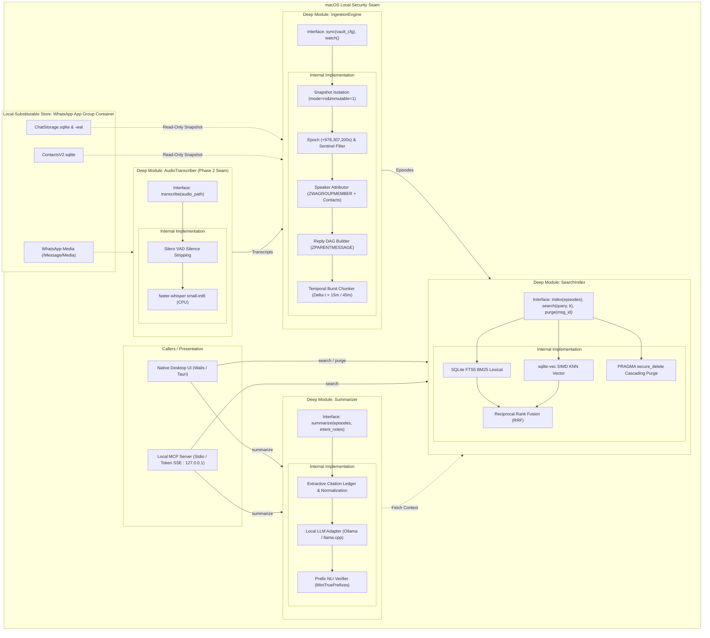

# macOS Desktop Architecture Specification

## 1. High-Level Modular Design

The system operates as an edge-native, zero-cost intelligence engine executing within the macOS local security seam. Rather than fracturing logic across shallow pass-through layers, the architecture concentrates complexity into four **deep modules** that provide high leverage for callers and strict locality for maintainers.



---

## 2. Deep Module Specifications

### 2.1 IngestionEngine
A deep module encapsulating container introspection, snapshot management, CoreData relational joins, timestamp normalization, and conversational graph stitching behind a minimal interface.

* **Interface:**
  ```typescript
  interface IngestionEngine {
    sync(vaultConfig: VaultConfig): Promise<SyncResult>;
    watch(vaultConfig: VaultConfig): AsyncIterable<EpisodeEvent>;
  }
  ```
  * Callers pass only the opt-in chat criteria (`VaultConfig`).
  * Invariants, lock-free file reads, and relational mapping remain completely internal.

* **Internal Implementation:**
  * **Snapshot Isolation:** Connects via `file:ChatStorage.sqlite?mode=ro&immutable=1` or copies `ChatStorage.sqlite`, `-wal`, `-shm`, and `ContactsV2.sqlite` to an isolated temp snapshot directory to prevent `0xDEAD10CC` app kill / write contention.
  * **Timestamp Normalization:** Converts Apple Epoch (`ZMESSAGEDATE`, `ZSENTDATE`) to Unix Epoch by adding `978,307,200` seconds.
  * **Sentinel Filtering:** Excludes 32-bit sentinel clusters in `ZSORT` ($\approx 214,748,3xx$) and `ZMESSAGECOUNTER` ($2,147,473,649$). Orders messages by normalized `ZMESSAGEDATE ASC, Z_PK ASC`.
  * **Speaker Resolution:** Joins `ZWAMESSAGE.ZGROUPMEMBER` -> `ZWAGROUPMEMBER.ZMEMBERJID`, maps display names via `ZWAPROFILEPUSHNAME`, and joins `ContactsV2.sqlite` (`ZWAADDRESSBOOKCONTACT.ZFULLNAME`).
  * **Reply DAG Assembly:** Maps parent message relationships via `ZPARENTMESSAGE` into a Directed Acyclic Graph (DAG) across intervening conversation.
  * **Temporal Burst Chunking:** Segments messages by inactivity gap ($\Delta t > 15 \text{m}$ for groups, $\Delta t > 45 \text{m}$ for 1:1 chats) into coherent `ConversationalFlowEpisode` structures (5–25 messages) enriched with participant and thread metadata.

* **Seam & Testing:**
  * **Seam Classification:** Local-substitutable.
  * **Test Strategy:** Tested across the `sync()` interface using static SQLite test fixtures containing synthetic CoreData schemas. No micro-tests for internal queries.

---

### 2.2 AudioTranscriber (Phase 2)
A deep module at a hardware execution seam scheduled for Phase 2 implementation that isolates local machine learning audio inference from callers.

* **Interface:**
  ```typescript
  interface AudioTranscriber {
    transcribe(audioFilePath: string): Promise<AudioTranscript>;
  }
  ```

* **Internal Implementation:**
  * Ingests WhatsApp `.ogg` (Opus) voice notes from `ZWAMEDIAITEM` or local media paths.
  * Resamples audio to 16 kHz mono WAV via `ffmpeg` or native libopus decoder.
  * Executes `Silero VAD` to strip silence frames.
  * Transcribes via `faster-whisper` (`small-int8` or `medium-int8` model) at 4x realtime on CPU / Apple Silicon.
  * Returns formatted transcript with timestamps and speaker duration.

* **Seam & Testing:**
  * **Seam Classification:** Real seam with two adapters:
    1. *Production Adapter:* `FasterWhisperAdapter` invoking local quantized model.
    2. *Test Adapter:* `FakeAudioTranscriber` returning canned deterministic text.

---

### 2.3 SearchIndex
A deep module encapsulating hybrid lexical-vector storage, SIMD similarity, and cryptographic deletion behind an atomic interface.

* **Interface:**
  ```typescript
  interface SearchIndex {
    index(episodes: ConversationalFlowEpisode[]): Promise<void>;
    search(query: string, limit: number): Promise<ScoredEpisode[]>;
    purge(messageId: string): Promise<PurgeReport>;
  }
  ```

* **Internal Implementation:**
  * **Lexical Index:** SQLite `FTS5` virtual table with BM25 ranking for exact terms, names, and identifiers.
  * **Vector Index:** `sqlite-vec` SIMD KNN extension over dense embeddings generated locally.
  * **Reciprocal Rank Fusion (RRF):** Evaluates lexical and vector ranks inside a unified SQL query:
    $$RRF\_Score(e) = \frac{1.0}{60 + rank_{fts}(e)} + \frac{1.0}{60 + rank_{vec}(e)}$$
  * **Hard Cryptographic Purge:** On message revocation (`ProtocolMessage_REVOKE` / empty `ZTEXT`), removes raw message rows, recalculates parent episode vectors, and runs `PRAGMA secure_delete = ON` to overwrite deleted pages on disk.

* **Seam & Testing:**
  * **Seam Classification:** Local-substitutable.
  * **Test Strategy:** Tested directly against an in-memory or ephemeral SQLite database populated through `index()` and asserted through `search()` and `purge()`.

---

### 2.4 Summarizer
A deep module enforcing epistemic neutrality, quotation grounding, and factual verification over retrieved episodes.

* **Interface:**
  ```typescript
  interface Summarizer {
    summarize(episodes: ConversationalFlowEpisode[], intentNotes?: string): Promise<VerifiedSummary>;
  }
  ```

* **Internal Implementation:**
  * **Extractive Citation Ledger:** Enforces temperature $T = 0.0 - 0.1$ and strips evaluative adjectives and emotional speculation.
  * **Local LLM Execution:** Calls local `Ollama` or `llama.cpp` (`Qwen-2.5-7B` / `Llama-3.2-3B`) bound strictly to `127.0.0.1`.
  * **Prefix-Level NLI Verification:** Validates each generated claim sentence against source episodes using a local `MiniTruePrefixes` entailment model. Discards sentences failing entailment.
  * **Intent-Constrained Draft Staging:** When drafting replies, retrieves past user messages (`ZISFROMME = 1`) to style-match surface greetings while constraining content strictly to user intent bullets.

* **Seam & Testing:**
  * **Seam Classification:** True external / owned port with two adapters:
    1. *Production Adapter:* Local `OllamaAdapter` communicating over authenticated localhost.
    2. *Test Adapter:* `DeterministicMockLLMAdapter` verifying ledger constraints and NLI stripping without inference overhead.
