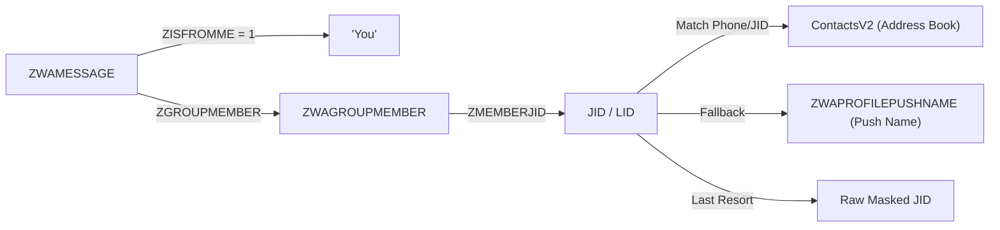

# Core Concepts & Architectural Mechanisms

This document explains the core domain concepts, data structures, and mathematical mechanisms powering Total Recall.

---

## 1. Conversational Flow Episodes

### The Problem: Message Fragmentation in Chat Apps
Unlike emails or documents, human communication on WhatsApp is highly fragmented:
- **One-line bursts**: A single thought is often split across 4–6 consecutive micro-messages:
  - *Message 1*: "hey"
  - *Message 2*: "about the vector db"
  - *Message 3*: "are we using sqlite-vec?"
  - *Message 4*: "or qdrant?"
- **Low semantic density**: Searching for "vector database choices" against isolated message rows fails because Message 1 and Message 3 contain partial phrases ("about the vector db", "or qdrant?") with almost zero individual embedding signal.
- **Interleaved topics**: In high-velocity groups, discussions on multiple unrelated topics intertwine concurrently.

```
Raw WhatsApp Stream:
[Msg 1: "hey"] -> [Msg 2: "lunch?"] -> [Msg 3: "sqlite-vec is great"] -> [Msg 4: "tacos?"] -> [Msg 5: "zero docker needed"]
                                         |                                                    |
                                         +------------------ Topic A -------------------------+
                          |                                                  |
                          +------------------------ Topic B -----------------+
```

### The Solution: The Episode Abstraction
A **Conversational Flow Episode** is a coherent conversational turn consisting of 5 to 25 temporally linked messages, bounded by inactivity thresholds and enriched with structured participant and thread metadata.

```
+---------------------------------------------------------------------------------------------------+
| CONVERSATIONAL FLOW EPISODE                                                                       |
| Header: [Chat: Architecture WG (@g.us)] | [Date: 2026-10-22 09:00 - 09:04] | [Participants: Alice, Bob]   |
+---------------------------------------------------------------------------------------------------+
| Content:                                                                                          |
|   [msg_id: 101] Alice: Should we use sqlite-vec or an external vector DB?                       |
|   [msg_id: 102] Bob (reply to 101): sqlite-vec is zero-cost and embedded, no Docker needed.      |
|   [msg_id: 103] You (reply to 102): Agreed, Simon Willison showed sqlite-vec works cleanly.      |
+---------------------------------------------------------------------------------------------------+
```

### Dynamic Temporal Burst Segmentation
Rather than segmenting messages by arbitrary token counts or fixed windows, Total Recall uses **inactivity gap thresholding**:
- **Active Group Chats (`@g.us`)**: A silence gap of $\Delta t > 15 \text{ minutes}$ (900 seconds) triggers an episode boundary.
- **1:1 Direct Chats (`@s.whatsapp.net`)**: A silence gap of $\Delta t > 45 \text{ minutes}$ (2700 seconds) triggers an episode boundary.

### Cross-Burst Context Stitching
When a participant quotes a message sent in an earlier episode (e.g., replying 2 hours later to a morning agreement), the chunker extracts the parent quote and injects it into the child episode's turn:
```
[msg_id: 205 | 2026-10-22 11:30:00 UTC] Alice Chen (in reply to earlier msg_id 102 from Bob Smith: 'sqlite-vec is zero-cost...'):
Going back to Bob's point, let's verify FTS5 tokenization.
```
This guarantees that semantic search on the later episode still captures the conversational context without needing to ingest the entire historical backlog.

### How Episodes Are Used Across the Pipeline
1. **Indexing Unit**: Each episode is indexed as a single document in SQLite `FTS5` (BM25 keyword search).
2. **Embedding Unit**: A dense vector representation (e.g. 384-dim embedding) is generated for each episode header + body.
3. **Retrieval Unit**: RRF queries rank and return full episodes, providing callers with immediate conversational context.
4. **Synthesis Context**: Episodes serve as grounded inputs into the local LLM summarizer with zero hallucinations.

---

## 2. Quoted Reply DAGs (Directed Acyclic Graphs)

### Why Chat History Is a Graph, Not a List
In flat linear scrollback, conversations in busy groups appear chaotic. Three people might be discussing a bug, while two others discuss dinner.

In WhatsApp:
- Outbound quotes and replies reference a specific parent message.
- In macOS CoreData (`ChatStorage.sqlite`), `ZWAMESSAGE.ZPARENTMESSAGE` stores the foreign key pointing to the parent message's `Z_PK`.

### DAG Structure
By modeling `parent_id -> child_ids` relationships, Total Recall builds a **Directed Acyclic Graph (DAG)**:
- **Root Messages**: Messages with `ZPARENTMESSAGE IS NULL` initiate a thread or broadcast a topic.
- **Thread Branches**: Consecutive replies branch off root or intermediate nodes.
- **Topological Sorting**: Preserves the logical progression of arguments even if hours of intervening messages intervened.

```
• [msg_id: 1] Alice: Should we use sqlite-vec or Qdrant?
  ├── [msg_id: 2] Bob: sqlite-vec is zero-cost and embedded.
  │     ├── [msg_id: 3] You: Agreed, Simon Willison showed it works.
  │     └── [msg_id: 8] Alice: Going back to Bob's point, check tokenization.
  └── [msg_id: 4] Charlie: What about memory usage?
        └── [msg_id: 5] You: Active working set is under 50MB.
```

---

## 3. Apple Epoch Timestamp Normalization

### The 31-Year Time Slip
Standard Unix timestamps count seconds elapsed since **January 1, 1970 00:00:00 UTC** (Unix Epoch).

macOS and iOS Apple CoreData frameworks (`ChatStorage.sqlite`) store timestamps (`ZMESSAGEDATE`, `ZSENTDATE`) as floating-point seconds elapsed since **January 1, 2001 00:00:00 UTC** (Apple Epoch).

$$\text{Apple Epoch Offset} = 978,307,200 \text{ seconds}$$
$$(31 \text{ years} + 8 \text{ leap days})$$

$$\text{Unix Timestamp} = \text{Apple Timestamp} + 978,307,200$$

### Why It Matters
Failing to add `978,307,200` causes all messages to appear 31 years in the past (e.g., a message sent in October 2026 displays as October 1995). Total Recall normalizes all timestamps at the ingestion seam before any sorting or episode chunking.

---

## 4. 32-Bit Sentinel Overflow Filtering

### The Sentinel Anomaly
In long-running WhatsApp accounts on Apple devices, internal sorting columns frequently store boundary sentinel values:
- `ZWAMESSAGE.ZSORT`: Boundary clusters near $214,748,3xx$ ($\approx \text{INT32\_MAX} / 10$).
- `ZWACHATSESSION.ZMESSAGECOUNTER`: Overflow values reaching $2,147,473,649$ ($\approx \text{INT32\_MAX} - 9,998$).

### The Invariant
**Never sort messages by `ZSORT`**. Sorting by `ZSORT` pushes sentinel messages to the end of the conversation or causes temporal interleaving bugs.

Total Recall enforces a strict sorting invariant across all queries:
```sql
ORDER BY ZMESSAGEDATE ASC, Z_PK ASC
```
This guarantees exact chronological ordering regardless of internal sort flags.

---

## 5. Multi-Party Group Speaker Attribution

### The Attribution Topology in Group Chats
In 1:1 direct chats (`@s.whatsapp.net`), identifying the sender is trivial:
- `ZISFROMME = 1`: Sent by you ("You").
- `ZISFROMME = 0`: Sent by the partner.

In group chats (`@g.us`), `ZWAMESSAGE` does not store the author's name or phone number directly:
1. `ZWAMESSAGE.ZISFROMME = 1` $\to$ Attributed directly to **"You"**.
2. `ZWAMESSAGE.ZGROUPMEMBER` $\to$ Foreign key to `ZWAGROUPMEMBER.Z_PK`.
3. `ZWAGROUPMEMBER.ZMEMBERJID` $\to$ Returns the member's JID (phone `@s.whatsapp.net` or privacy LID `@lid`).
4. `ContactsV2.sqlite` (`ZWAADDRESSBOOKCONTACT`) $\to$ Maps the JID to the contact's real address book name (`ZFULLNAME`).
5. `ZWAPROFILEPUSHNAME` $\to$ Fallback to the self-assigned WhatsApp display name (`ZPUSHNAME`).
6. Fallback $\to$ Masked JID/LID.



---

## 6. Zero-Cost Local Hybrid Search (FTS5 + Vector + RRF)

### The Tradeoff: Cloud Vector DBs vs SQLite Edge
Traditional RAG pipelines require running external vector databases (Qdrant, OpenSearch, Milvus) in Docker or paying cloud SaaS fees. This violates Total Recall's zero-cost and privacy-first constraints.

Total Recall combines lexical search and dense vector search inside a single local SQLite file:
- **Lexical Search (SQLite FTS5)**: BM25 ranking using the `porter unicode61` tokenizer. Matches exact keywords, codes, model names, phone numbers, and URLs with 0 latency.
- **Vector Search (`sqlite-vec` / SIMD KNN)**: Computes dense vector similarity over text embeddings. Matches conceptual meaning (e.g. searching "laptop memory usage" finds "working set under 50MB").

### Reciprocal Rank Fusion (RRF)
BM25 scores and cosine distances operate on completely different numerical scales. Instead of brittle score normalization, **Reciprocal Rank Fusion (RRF)** merges rank positions:

$$RRF\_Score(e) = \frac{1.0}{k + rank_{fts}(e)} + \frac{1.0}{k + rank_{vec}(e)}$$

Where:
- $rank_{fts}(e)$ is the 1-based rank from BM25.
- $rank_{vec}(e)$ is the 1-based rank from vector similarity.
- $k$ is the smoothing constant (standard $k = 60$).

```sql
WITH fts_results AS (
    SELECT id, ROW_NUMBER() OVER (ORDER BY rank) AS rank_fts
    FROM episodes_fts WHERE episodes_fts MATCH :query LIMIT 20
),
vec_results AS (
    SELECT id, ROW_NUMBER() OVER (ORDER BY cosine_dist(embedding, :vec) ASC) AS rank_vec
    FROM episode_vectors LIMIT 20
),
candidates AS (
    SELECT id FROM fts_results UNION SELECT id FROM vec_results
)
SELECT
    c.id,
    e.header,
    (coalesce(1.0 / (60.0 + f.rank_fts), 0.0) + coalesce(1.0 / (60.0 + v.rank_vec), 0.0)) AS rrf_score
FROM candidates c
JOIN episodes e ON e.id = c.id
LEFT JOIN fts_results f ON f.id = c.id
LEFT JOIN vec_results v ON v.id = c.id
ORDER BY rrf_score DESC LIMIT 5;
```

---

## 7. Epistemic Neutrality & Extractive Summarization

### Preventing LLM Hallucinations on Private Data
Standard LLM summaries frequently hallucinate false agreements, emotional speculation, or incorrect dates.

Total Recall enforces **Epistemic Neutrality**:
1. **Zero Temperature**: Inference executed at $T = 0.0$.
2. **Negative Constraints**: The prompt explicitly forbids emotional speculation or psychological inference ("court-reporter style").
3. **Mandatory Citation Ledger**: Every asserted statement must terminate in a verifiable citation:
   ```
   [Chat | Date | Sender | msg_id]
   ```

### The CitationVerifier
Before displaying any summary or reply draft, the `CitationVerifier` parses all citations and cross-checks them:
- Does `msg_id` exist in the raw SQLite database?
- Does the cited sender match `ZWAMESSAGE` attribution?
- Does the date align with `ZMESSAGEDATE`?

Any sentence failing citation validation is flagged or stripped.

---

## 8. Lock-Free Concurrency & 0xDEAD10CC Prevention

### The Concurrency Hazard
WhatsApp Desktop continuously writes to `ChatStorage.sqlite-wal` at 65–93 KB/s. If a local process opens the SQLite database with shared read-write locks or holds open transactions during system suspension, macOS terminates WhatsApp with exception code:
`0xDEAD10CC` (*Resource lock held during suspension*).

### The Solution: Immutable Read-Only Flags
Total Recall opens connections using SQLite's URI immutable read-only flags:
```python
uri = f"file:{path}?mode=ro&immutable=1"
con = sqlite3.connect(uri, uri=True)
```
- `mode=ro`: Opens the file as read-only.
- `immutable=1`: Informs SQLite that the underlying file will never be modified by this connection and bypasses all shared memory (`-shm`) and WAL coordination locks.
- Result: **Zero lock contention with WhatsApp Desktop, zero crash risk.**
